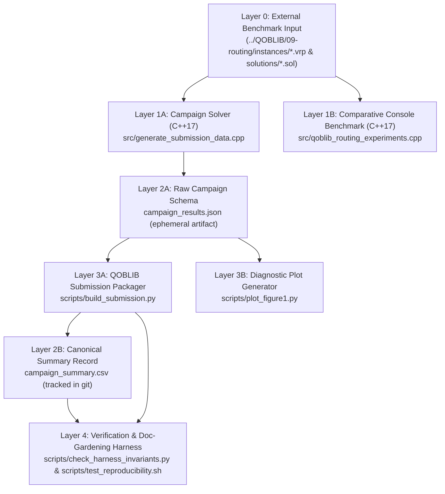

# ARCHITECTURE.md — System Map & Dependency Layers

This document provides a high-level architectural map of `qoblib-routing-exact-sqa`, its strict forward-only data flow, and boundary invariants.

---

## 1. Layered Architecture & Data Flow

Code and data in this repository flow strictly **top-to-bottom** through five decoupled layers. No layer may depend "backward" on a downstream layer.

---

## 2. Directory & Component Boundaries

| Layer | Path | Responsibility | Allowed Dependencies |
| :--- | :--- | :--- | :--- |
| **Layer 1 (Solvers)** | [`src/generate_submission_data.cpp`](src/generate_submission_data.cpp) [`src/qoblib_routing_experiments.cpp`](src/qoblib_routing_experiments.cpp) | Parses `.vrp` instances, enumerates $\mathcal{F}_1$ & $\mathcal{P}_4$, runs Held-Karp DP, `TC-Exact`, `SQA-Subspace`, and `SQA-Direct`. | C++17 Standard Library only (`<iostream>`, `<vector>`, `<random>`, `<chrono>`, `<filesystem>`). |
| **Layer 2 (Data Record)** | [`campaign_summary.csv`](campaign_summary.csv) | Versioned system-of-record table for all 55 instances (12 columns). | Generated deterministically by [`scripts/build_submission.py`](scripts/build_submission.py) from `campaign_results.json`. |
| **Layer 3 (Tooling)** | [`scripts/build_submission.py`](scripts/build_submission.py) [`scripts/plot_figure1.py`](scripts/plot_figure1.py) | Transforms `campaign_results.json` into QOBLIB submission trees (`20261017_TCExact_Vuong`), [`campaign_summary.csv`](campaign_summary.csv), and `fig1_sqa_analysis.pdf`. | Python 3 standard library (`json`, `csv`, `argparse`, `pathlib`) + `matplotlib` (only in `plot_figure1.py`). |
| **Layer 4 (Harness)** | [`scripts/check_harness_invariants.py`](scripts/check_harness_invariants.py) [`scripts/test_reproducibility.sh`](scripts/test_reproducibility.sh) | Mechanically enforces documentation cross-links, table-to-CSV synchronization, path hygiene, and QOBLIB `check_submission.py` validation. | Python 3 standard library, `bash`, `clang++`, and `../QOBLIB/misc/ci/check_submission.py`. |
| **Knowledge Store** | [`AGENTS.md`](AGENTS.md), [`docs/`](docs/index.md), [`CITATION.cff`](CITATION.cff) | Versioned documentation system of record for humans and agents. | Validated mechanically by [`scripts/check_harness_invariants.py`](scripts/check_harness_invariants.py). |

---

## 3. Boundary Invariants ("Parse, Don't Validate")

1. **Input Boundary (`read_vrp` in C++17):**
   - Reads `DIMENSION`, `CAPACITY`, `NODE_COORD_SECTION`, and `DEMAND_SECTION` from `.vrp` files.
   - Immediately computes the integer distance matrix `dist[i][j] = std::llround(std::hypot(dx, dy))` matching QOBLIB's `EUC_2D` convention (`cvrp_ilp.zpl` and `check_cvrp`).
   - Enforces 0-based internal customer indexing `0..19` (`mask` bit $i \leftrightarrow$ customer $i+1$, depot $= 0$) and outputs 1-based customer IDs `1..20` in `.sol` files.
2. **JSON Schema Boundary (`campaign_results.json`):**
   - Array of 55 objects containing: `instance`, `capacity`, `num_subsets`, `num_partitions`, `nonzeros`, `min_coeff`, `max_coeff`, `exact_cost`, `second_best_cost`, `exact_total_s`, `exact_tts_s`, `sqa_best_cost`, `sqa_succ_runs`, `sqa_mean_total_s`, `sqa_mean_tts_s`, `routes` (4 arrays of customer IDs), and `traces` (5 arrays of `{Time, Incumbent, step}`).
3. **Documentation Sync Boundary:**
   - Every row of the 55-instance markdown table in [`README.md`](README.md) must match [`campaign_summary.csv`](campaign_summary.csv). This invariant is verified automatically by [`scripts/check_harness_invariants.py`](scripts/check_harness_invariants.py).
